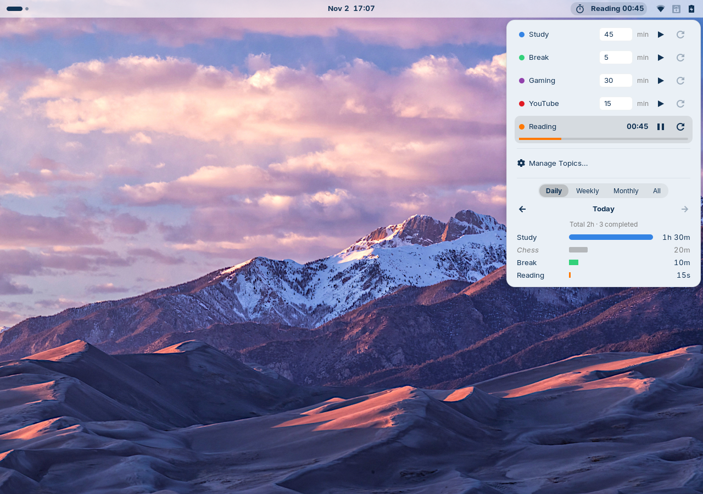
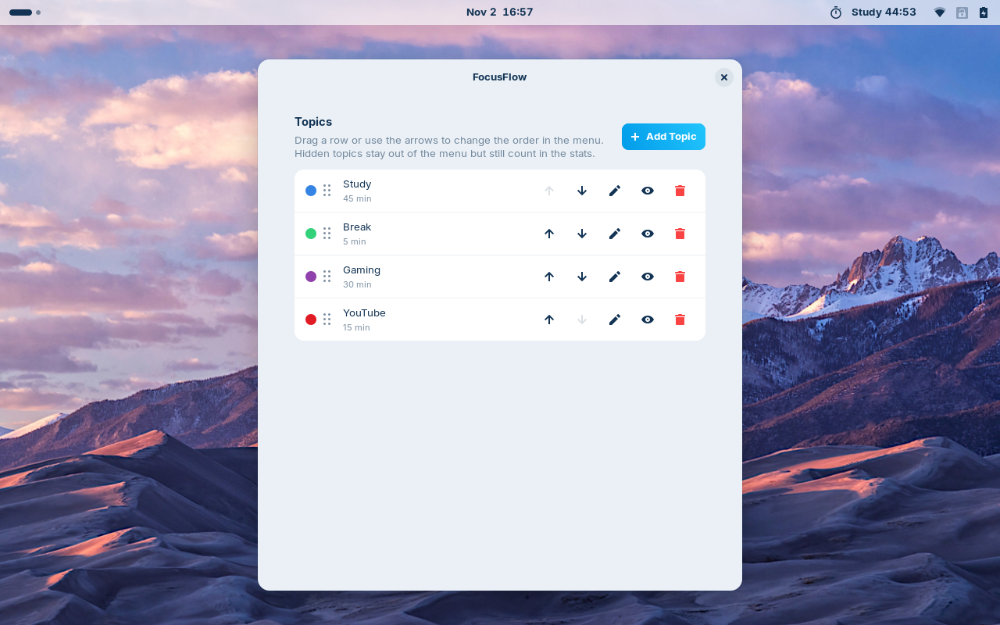
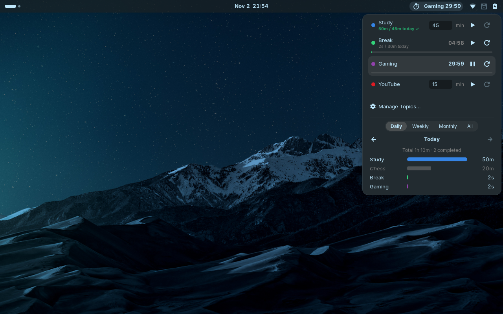
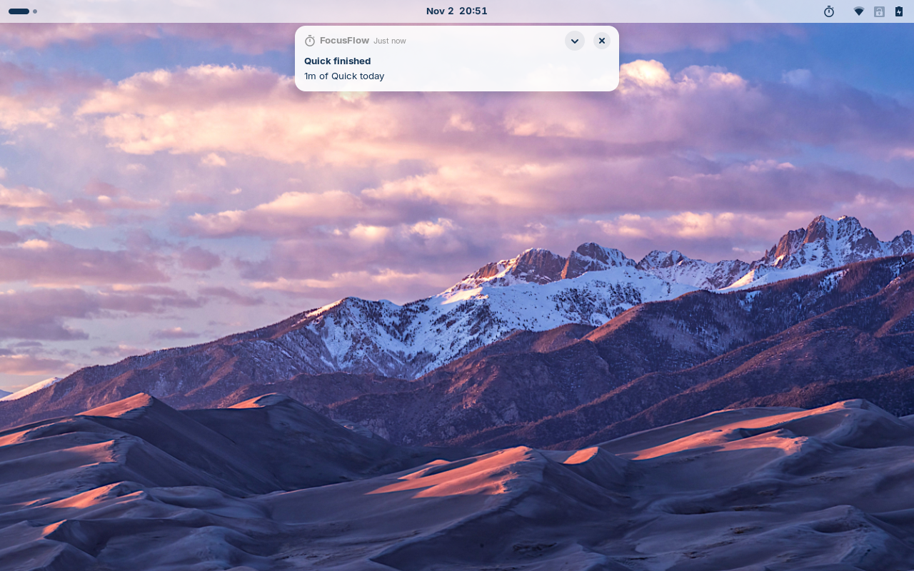

# FocusFlow

A GNOME Shell extension for Pomodoro-style timers and time tracking, right in
the top panel. Give each activity (Study, Break, Gaming, ...) its own timer,
see where your time goes per day, week and month, and get a chime when a timer
is done.



## Features

- **One timer per topic** with play/pause and reset. Only one runs at a time:
  starting another topic pauses the current one, and each topic keeps its own
  paused progress. Edit a topic's minutes right in the menu.
- **Panel countdown:** `Study 23:41` while running, `⏸ Study 12:05` while
  paused. Middle-click the icon to pause/resume. Can be switched to icon only.
- **Stats:** Daily, Weekly, Monthly and All-time totals per topic as colored
  bars, with ‹ › to look at earlier periods. The running timer counts live.
- **When a timer finishes:** a short chime and a notification with today's
  total for that topic, and a **Start Again** button.
- **Auto-start:** start a chosen topic (e.g. Break) automatically after others
  (e.g. Study) finish.
- **Daily goals** per topic: `40m / 2h today`, with a ✓ once reached.
- **Keyboard shortcut** (default <kbd>Super</kbd>+<kbd>Alt</kbd>+<kbd>P</kbd>):
  pause the running timer, resume the last paused one, or start the last used
  topic.
- **Manage Topics:** add, edit, reorder (drag or arrows), hide from the menu,
  and delete with or without its history.
- **Backup:** export everything as JSON or the history as CSV, import a backup
  (replace or merge), or reset all data.
- **Reliable:** timers run on the wall clock, so they stay correct across
  closing the menu, screen lock, suspend, logout and shell restarts. A timer
  that ran out meanwhile is logged with its real end time.

| Manage Topics | Dark theme | Finished |
|---|---|---|
|  |  |  |

## Requirements

- GNOME Shell 46 (Wayland or X11), e.g. Zorin OS 18 or Ubuntu 24.04

## Install

From a release zip:

```bash
gnome-extensions install focusflow@rahulrgd.github.io.shell-extension.zip
```

Then log out and back in (required on Wayland for a newly installed
extension) and enable it:

```bash
gnome-extensions enable focusflow@rahulrgd.github.io
```

From source:

```bash
./scripts/install.sh   # compiles the schema and symlinks this folder
```

## Usage

Click the stopwatch icon in the top panel:

1. **Timers:** one row per visible topic. ▶ starts or resumes, ⏸ pauses,
   ↺ resets. Type new minutes in the box and press Enter (applies to the next
   start).
2. **Manage Topics…** opens the preferences window.
3. **Stats:** pick Daily / Weekly / Monthly / All; ‹ › moves between periods.

The preferences window (**Manage Topics…**, or
`gnome-extensions prefs focusflow@rahulrgd.github.io`) has three pages:

- **Topics:** add, edit (name, minutes, color, daily goal), reorder, hide,
  delete.
- **Settings:**

  | Setting | Default |
  |---|---|
  | Play a sound | on (plays even with Do Not Disturb) |
  | Show a notification | on |
  | Show topic and countdown in the top bar | on |
  | First day of the week | Monday |
  | Auto-start next topic | off |
  | Pause / resume shortcut | `<Super><Alt>p` (empty = off) |

- **Backup:** export, import, reset.

## Your data

- **Topics and settings:** GSettings,
  `dconf dump /org/gnome/shell/extensions/focusflow/`
- **History:** `~/.local/share/focusflow/sessions.jsonl`, one JSON object per
  session (`topicId`, `topicName`, `start`, `end`, `seconds`, `completed`).
  Every stretch of running time is logged, also when you pause or reset, so
  the stats show the time you actually spent. A session that crosses midnight
  is split between the two days (45 minutes from 11:50 PM: 10 minutes on the
  first day, 35 on the next), also in the CSV export.
- Nothing leaves your computer.

## Lock screen

FocusFlow stays enabled on the lock screen (`session-modes` includes
`unlock-dialog`) so a timer that runs out while the screen is locked still
plays its chime and shows its notification. The panel icon and menu are
hidden while the screen is locked.

## Development

```bash
glib-compile-schemas schemas && gjs -m tests/run.js   # unit tests
./scripts/headless.sh                                  # throwaway headless shell, isolated from your desktop
./scripts/headless.sh --unsafe -- <command>            # run a test command inside it (Eval enabled)
./scripts/nested.sh                                    # nested Wayland session to try it by hand
./scripts/pack.sh                                      # dist/focusflow@rahulrgd.github.io.shell-extension.zip
journalctl -f -o cat /usr/bin/gnome-shell              # extension logs
journalctl -f -o cat /usr/bin/gjs                      # preferences window logs
```

`sounds/done.oga` is generated by `scripts/make-sound.py` (needs ffmpeg).
`PLAN.md` has the design decisions and test results per phase.

## License

GPL-2.0-or-later, see [LICENSE](LICENSE).
